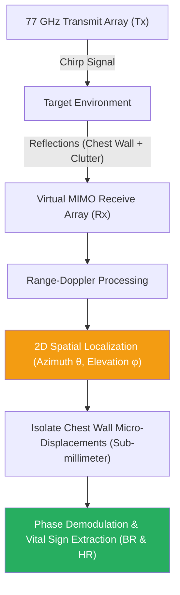
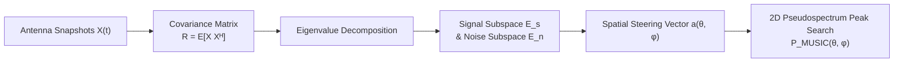
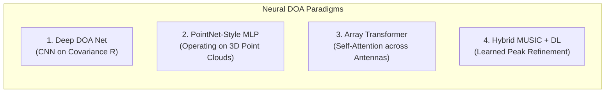
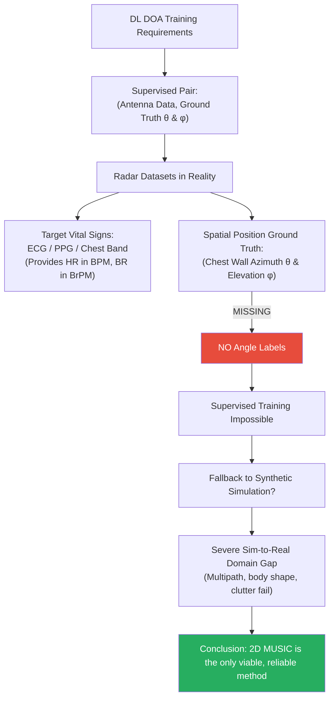

# 2D MUSIC vs. Deep Learning for DOA Estimation in mmWave Radar Vital Signs

> [!IMPORTANT]
> **Core Architectural Decision:** We utilize **2D MUSIC** for Direction of Arrival (DOA) estimation rather than end-to-end Deep Learning (DL) models. While replacing 2D MUSIC with a neural network is an active theoretical research topic, real-world deployment is bottlenecked by the **complete absence of spatial angle ground truth annotations** in radar datasets. 2D MUSIC provides high-resolution, training-free, mathematically grounded spatial localization directly from raw antenna array covariance matrices.

---

## 1. The Role of DOA Estimation in Radar Vital Signs

In FMCW mmWave radar systems (such as 77 GHz systems with virtual MIMO arrays), electromagnetic chirps reflect off both the human subject and surrounding objects (chairs, walls, interior fixtures, steering wheels).

### Why Joint 2D DOA (Azimuth + Elevation) is Critical
1. **Target Disambiguation:** A 1D angle scan (azimuth only) cannot distinguish between a reflection coming from the chest versus reflections from the lap, hands, or ceiling at the same horizontal bearing.
2. **Optimal Phase Extraction:** Vital sign extraction relies on tracking sub-millimeter chest displacement via phase demodulation:
   $$\Delta \phi(t) = \frac{4\pi \Delta d(t)}{\lambda}$$
   Selecting the wrong spatial bin injects multipath noise and harmonic clutter that completely drowns out subtle cardiopulmonary vibrations (~0.1 mm for heartbeats, 1–5 mm for respiration).

---

## 2. Mathematical Principles of 2D MUSIC

**MUSIC (MUltiple SIgnal Classification)** is an eigenvalue-based super-resolution algorithm operating on the spatial covariance matrix of an antenna array.

### 1. Covariance Matrix Estimation
For $M$ virtual antenna elements and $K$ time snapshots:
$$\mathbf{R}_{xx} = \frac{1}{K} \sum_{k=1}^{K} \mathbf{x}(k) \mathbf{x}^H(k)$$

### 2. Subspace Decomposition
Performing eigendecomposition on $\mathbf{R}_{xx}$:
$$\mathbf{R}_{xx} = \mathbf{U} \mathbf{\Sigma} \mathbf{U}^H = \mathbf{E}_s \mathbf{\Sigma}_s \mathbf{E}_s^H + \mathbf{E}_n \mathbf{\Sigma}_n \mathbf{E}_n^H$$
- $\mathbf{E}_s$: Eigenvectors corresponding to the $D$ largest eigenvalues spanning the **signal subspace**.
- $\mathbf{E}_n$: Eigenvectors corresponding to the remaining $M - D$ eigenvalues spanning the **noise subspace**.

### 3. Orthogonality & Spatial Pseudospectrum
Because the steering vectors of incoming wavefronts $\mathbf{a}(\theta, \phi)$ are orthogonal to the noise subspace $\mathbf{E}_n$:
$$P_{\text{2D-MUSIC}}(\theta, \phi) = \frac{1}{\mathbf{a}^H(\theta, \phi) \mathbf{E}_n \mathbf{E}_n^H \mathbf{a}(\theta, \phi)}$$

Where $\mathbf{a}(\theta, \phi)$ encodes the 2D array geometry for azimuth angle $\theta$ and elevation angle $\phi$:
$$\mathbf{a}(\theta, \phi) = \left[ 1, e^{j \frac{2\pi}{\lambda}(x_1 \sin\theta \cos\phi + y_1 \sin\phi)}, \dots, e^{j \frac{2\pi}{\lambda}(x_{M-1} \sin\theta \cos\phi + y_{M-1} \sin\phi)} \right]^T$$

When $(\theta, \phi)$ matches the exact direction of the chest wall, the denominator approaches zero, producing a sharp super-resolution peak in the 2D angular spectrum.

---

## 3. Deep Learning Alternatives: Theoretical Potential

Replacing or augmenting classical 2D MUSIC with deep learning is often proposed as a novel, highly publishable research direction. The primary architectures investigated in literature include:

### Approach 1: Deep DOA Net (CNN on Covariance Matrix)
- **Concept:** Feed the real and imaginary components of $\mathbf{R}_{xx}$ into a 2D convolutional network to directly regress $(\theta, \phi)$ or output an angular heatmap.
- **Theoretical Advantage:** Bypasses computationally intensive eigendecomposition $\mathcal{O}(M^3)$ and exhaustive 2D grid searches $\mathcal{O}(N_\theta \times N_\phi \times M^2)$.

### Approach 2: PointNet-Style (3D Point Cloud Representation)
- **Concept:** Transform radar detections into sparse point clouds $(x, y, z, \text{Doppler}, \text{SNR})$ and use symmetric pooling to segment points corresponding to the thorax.
- **Theoretical Advantage:** Permutation-invariant, handles variable numbers of radar reflection points naturally.

### Approach 3: Array Transformer (Self-Attention over Virtual Channels)
- **Concept:** Treat each virtual antenna channel as an input token. Self-attention layers model inter-element phase differences and spatial correlations across the aperture.
- **Theoretical Advantage:** Captures non-linear mutual coupling and array imperfections that degrade classical steering vectors.

### Approach 4: Hybrid 2D MUSIC + DL (Spectrum Post-Processor)
- **Concept:** Compute a coarse 2D MUSIC spectrum and pass it to a lightweight U-Net or attention filter to suppress spurious sidelobes, multipath artifacts, and clutter peaks.
- **Theoretical Advantage:** Retains physics-based mathematical structure while letting neural layers learn environment-specific clutter distributions.

---

## 4. Why We Do NOT Use Deep Learning for DOA: The Data Bottleneck

Despite the theoretical benefits of neural DOA estimation, building a pure DL-based DOA pipeline in practice faces a fatal blocker: **the complete lack of spatial ground truth annotations**.

### 1. The Nature of Available Ground Truth
Standard radar physiological datasets use contact reference instruments:
- **Electrocardiogram (ECG):** Logs electrical heart activity (mV time series).
- **Photoplethysmogram (PPG / Pulse Oximeter):** Logs peripheral blood volume pulse.
- **Respiratory Chest Belts:** Logs chest circumference / pressure changes.

These sensors provide scalar biological rates:
$$\text{Ground Truth} = \{ \text{Heart Rate (BPM)}, \text{Breath Rate (BrPM)}, \text{Waveform}(t) \}$$
They provide **zero spatial coordinates** $(\theta, \phi, r)$ of where the chest reflection originated in 3D space.

### 2. High Cost of Angle Ground Truth Collection
Generating true $(\theta, \phi)$ labels per millisecond frame requires:
- Multi-camera optical motion capture rigs (e.g., Vicon / OptiTrack) with millimeter-calibrated optical markers placed directly on the subject's sternum.
- Strict extrinsic calibration between optical coordinate frames and radar antenna phase centers.
Such spatial labels are absent in virtually all open radar vital signs archives.

### 3. The Synthetic Data (Sim-to-Real) Trap
Attempting to train a neural DOA model on synthetic electromagnetic simulations (e.g., ray tracing, electromagnetic solvers) fails due to the **sim-to-real gap**:
- Human skin, clothing layers, and adipose tissue cause complex, non-ideal scattering.
- Multipath reflections inside real environments (interiors, enclosures, metal/glass boundaries) generate ghost targets not captured by simplified simulation models.
- When transferred to real raw ADC radar data, synthetic-trained models suffer massive angular drift and false peak selections.

---

## 5. Why 2D MUSIC is the Superior Choice

| Evaluation Metric | Deep Learning DOA | Classical 2D MUSIC | Our Pipeline Decision |
|---|---|---|---|
| **Ground Truth Requirement** | Strict per-frame $(\theta, \phi)$ labels required | **Zero training data needed** (Unsupervised) | **2D MUSIC** |
| **Generalization** | Degrades in unseen geometries/environments | **Universal** (governed by wave mechanics) | **2D MUSIC** |
| **Array Geometry Portability** | Requires retraining if antenna layout changes | **Configurable** via analytical steering vector $\mathbf{a}(\theta, \phi)$ | **2D MUSIC** |
| **Mathematical Interpretability** | Black-box output | **Strict subspace orthogonality guarantee** | **2D MUSIC** |
| **Super-Resolution** | Dependent on training distribution | **Exceeds Rayleigh diffraction limit** analytically | **2D MUSIC** |
| **Failure Modes** | Hallucinated angles under noise | Observable eigenvalue collapse | **2D MUSIC** |

### Key Strengths in Our Pipeline:
1. **Unsupervised Operation:** Operates directly on the incoming raw covariance matrix $\mathbf{R}_{xx}$ without any prior dataset training.
2. **Deterministic Super-Resolution:** Separates the chest wall from adjacent targets (headrest, dashboard, steering column) even when their angular separation is smaller than the antenna array's natural beamwidth.
3. **Plug-and-Play Antenna Modeling:** If the virtual MIMO layout changes (e.g., switching from 2 Tx / 4 Rx to 3 Tx / 4 Rx), only the steering vector matrix $\mathbf{a}(\theta, \phi)$ needs updating; no neural retrain cycle is needed.

---

## 6. Summary

- **Why DL DOA is attractive on paper:** Eliminates eigendecomposition and 2D grid searches, offering fast forward-pass inference and potential end-to-end optimization.
- **Why it cannot be used today:** No radar vital sign datasets provide ground truth 3D chest coordinates or angle trajectories $(\theta, \phi)$. Training without labels or relying on synthetic data leads to severe inaccuracies in real physical environments.
- **The Verdict:** **2D MUSIC is the mathematically sound, reliable, and production-ready solution.** It ensures robust spatial chest isolation without requiring any spatial training data.
