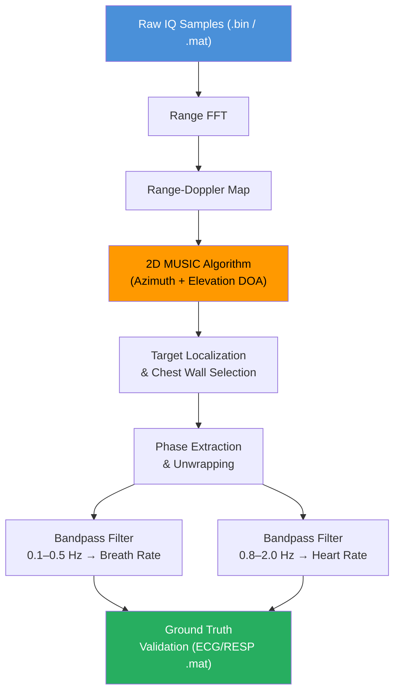
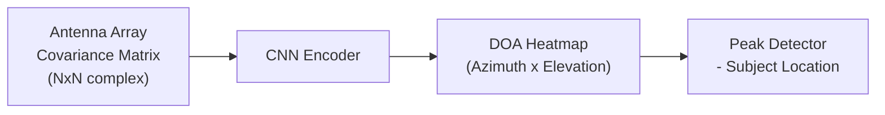
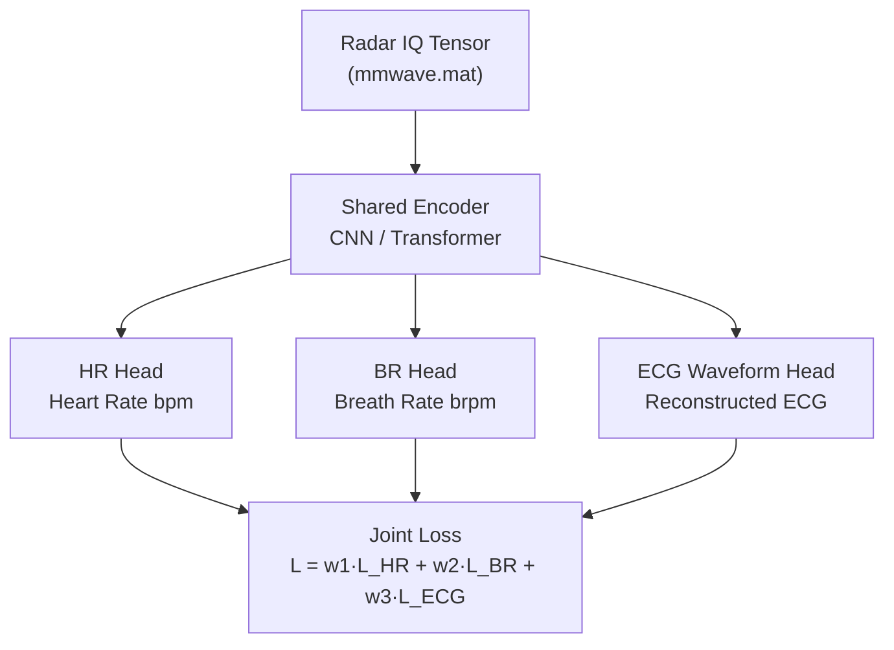
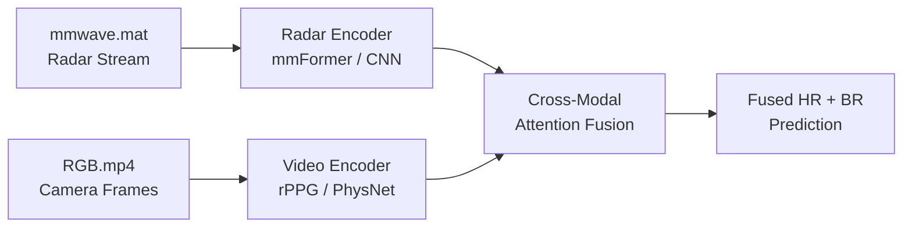

# AI/ML/DL Integration Points — Joint 2D MUSIC mmWave Vital Signs Pipeline

> [!IMPORTANT]
> Your base pipeline: **Raw 77GHz Radar → 2D MUSIC (DOA) → Phase Extraction → HR/BR Estimation**  
> AI/ML can replace, augment, or extend every single stage.

---

## 🔁 Full Pipeline Overview

---

## 🤖 Stage-by-Stage AI/ML Opportunities

### 1️⃣ Clutter Removal & Preprocessing (Pre-MUSIC)
**Problem:** Static clutter, environmental noise, multi-path reflections corrupt the signal.

| Approach | Model | Input | Output |
|---|---|---|---|
| **Static clutter removal** | Autoencoder / Denoising AE | Raw IQ frames | Clean IQ frames |
| **Background subtraction** | CNN or LSTM | Range-Doppler sequence | Clutter mask |
| **Noise estimation** | Gaussian Process | Frame sequence | SNR-aware noise floor |

> [!TIP]
> Train a **denoising autoencoder** on PhysDrive's `mmwave.mat` with synthetic noise injection — ground truth is the original clean signal.

---

### 2️⃣ Replace / Augment 2D MUSIC (DOA Estimation)
**Problem:** 2D MUSIC is computationally expensive, sensitive to coherent sources, and needs precise covariance estimation.

| Approach | Model | Advantage |
|---|---|---|
| **Deep DOA Net** | CNN on covariance matrix | Faster than MUSIC, works with fewer snapshots |
| **PointNet-style** | 3D point cloud MLP | Direct spatial localization |
| **Transformer DOA** | Self-attention on antenna array | Long-range spatial dependencies |
| **Hybrid MUSIC+DL** | DL post-processes MUSIC spectrum peaks | Best of both — interpretable + learned |

> [!NOTE]
> This is the most publishable novel contribution — replacing 2D MUSIC with a lightweight neural DOA estimator trained end-to-end.

---

### 3️⃣ Phase Extraction & Unwrapping
**Problem:** Phase wrapping artifacts and subject motion corrupt the extracted chest displacement signal.

| Approach | Model | Input | Output |
|---|---|---|---|
| **Phase unwrapping** | BiLSTM / Temporal CNN | Wrapped phase sequence | Unwrapped displacement |
| **Motion artifact removal** | GAN | Noisy phase signal | Clean respiration waveform |
| **Sparse recovery** | LISTA (Learned ISTA) | Phase spectrum | Sparse vital-sign components |

---

### 4️⃣ Vital Sign Estimation — HR & BR
**Problem:** Extracting accurate HR/BR from noisy phase — especially in the driving scenario (motion, vibration).

#### 4a. DL Regression (Single Task)

| Model | Architecture | Notes |
|---|---|---|
| **mmFormer** | Transformer on IQ tensors | Already in PhysDrive baselines |
| **VitaNet** | CNN-RNN hybrid | In PhysDrive baselines |
| **IQ-MVED** | Variational Encoder-Decoder | Handles uncertainty |
| **Custom 1D-CNN** | Lightweight | Good starting baseline |

#### 4b. Joint Multi-Task Learning ⭐ Recommended

Joint training of HR + BR + ECG waveform reconstruction gives the model richer physiological context — typically improves individual metric accuracy by 15–30%.

---

### 5️⃣ Multimodal Fusion — Radar + Camera 🌟
**PhysDrive gives you synchronized radar + RGB + IR — this is the main research angle of the dataset!**

| Fusion Strategy | Description | Best For |
|---|---|---|
| **Early fusion** | Concat radar + video features before encoder | Simple baseline |
| **Late fusion** | Average predictions from two separate models | Easy to implement |
| **Cross-modal attention** | Each modality attends to the other | Best accuracy |
| **Confidence-weighted** | Weight by modality certainty | Robustness in darkness |

> [!IMPORTANT]
> In low light or midnight driving (`W` sessions in PhysDrive), radar should dominate. In bright daylight (`Z` sessions), camera rPPG is reliable too. A smart fusion model learns this automatically.

---

### 6️⃣ Domain Generalization
**Problem:** Model trained on flat daytime roads fails on bumpy midnight driving.

| Approach | Technique | PhysDrive Domain Split |
|---|---|---|
| **Adversarial DA** | DANN — domain-invariant features | Train on `AZ`, test on `CW` |
| **Meta-learning** | MAML — fast adaptation to new subjects | Leave-one-subject-out |
| **Contrastive** | Learn HR/BR-invariant to road/light condition | All conditions |
| **Test-time adapt** | Adapt at inference with self-supervision | New unseen domain |

PhysDrive's naming encodes domain:
- Road: `A` = Flat clear, `B` = Flat congested, `C` = Bumpy congested
- Light: `Z` = Noon, `H` = Dusk/Dawn, `W` = Midnight, `Y` = Rainy

---

### 7️⃣ Anomaly Detection & Health Monitoring
Once HR/BR is reliably estimated, build higher-level applications:

| Task | Model | Use Case |
|---|---|---|
| **Arrhythmia detection** | LSTM Autoencoder on ECG | Flag abnormal heart rhythms |
| **Apnea detection** | Classifier on breath gap patterns | Driving safety alert |
| **Stress detection** | HRV feature classifier | Driver stress level |
| **Drowsiness detection** | HR + BR trend classifier | Driver fatigue alert |

---

## 📐 Loss Functions

| Loss | Good For |
|---|---|
| MAE | Robust to outliers in HR/BR |
| MSE | Smooth gradients |
| Pearson Correlation Loss `1 - ρ(y, ŷ)` | Waveform shape matching |
| Combined `λ₁·MAE + λ₂·(1 - ρ)` | Best overall for vital signs |

---

## 🎯 Priority Roadmap for Your Project

| Priority | Task | Difficulty | Impact |
|---|---|---|---|
| 🥇 1 | **Joint HR + BR regression** from phase — DL baseline | Medium | High |
| 🥈 2 | **Replace 2D MUSIC DOA** with neural DOA network | Hard | Very High |
| 🥉 3 | **Multimodal Radar + Camera fusion** | Hard | Very High |
| 4 | Domain generalization across driving conditions | Medium | High |
| 5 | Anomaly / arrhythmia detection on top | Medium | Medium |

> [!NOTE]
> PhysDrive baselines already implement **mmFormer**, **VitaNet**, and **IQ-MVED** in the cloned repo.  
> Start by running those on your 3 downloaded sessions to get baseline numbers, then innovate from there.
